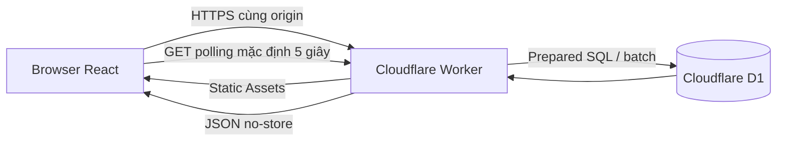
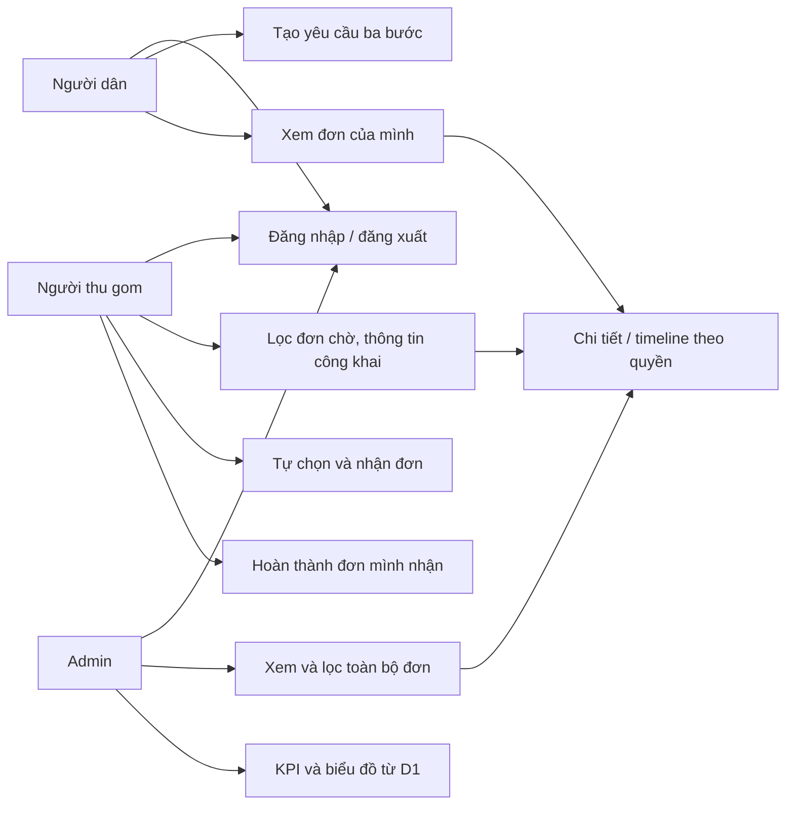
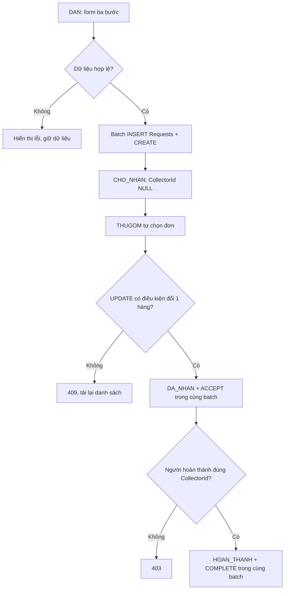

# Kiến trúc Recycle Connect

## Thành phần

React/Vite/Tailwind được build thành static assets. Cùng một Cloudflare Worker phục vụ assets và REST JSON API; `/api/*` chạy Worker trước SPA fallback. Trình duyệt gửi cookie cùng origin; không cần CORS wildcard. D1 giữ dữ liệu chung giữa các phiên/thiết bị. Thời gian lưu UTC ISO 8601, ngày nghiệp vụ/hiển thị dùng `Asia/Ho_Chi_Minh`.



Worker không giữ session trong RAM: token ngẫu nhiên 256 bit ở cookie HttpOnly, SHA-256 token ở D1, hết hạn sau tám giờ và có thể thu hồi. PBKDF2-SHA256 giữ nguyên 310000 vòng, salt ngẫu nhiên 32 byte được mã hóa hex rồi dùng dưới dạng UTF-8. Seed và Worker dùng chung policy. Không ghi token/password/địa chỉ vào log.

GET và POST đều kiểm tra session tại backend; mỗi route kiểm tra vai trò và từng đơn kiểm tra chủ sở hữu/người thu gom. POST yêu cầu Origin hợp lệ. Login có limiter 10 lần/60 giây theo IP tại từng location, có thể ảnh hưởng người dùng chung NAT; không phải giới hạn toàn cầu chính xác. Không dùng biến RAM của Worker làm cơ chế chống nhận trùng.

## Use case



## Luồng trạng thái



## Hai người tranh nhận

```mermaid
sequenceDiagram
  participant A as Session TG01
  participant B as Session TG02
  participant W as Worker
  participant D as D1
  par Hai HTTP client độc lập
    A->>W: POST /requests/id/accept
    B->>W: POST /requests/id/accept
  end
  W->>D: batch A: conditional UPDATE; INSERT log WHERE changes()=1
  D-->>W: UPDATE 1 hàng; một ACCEPT; commit
  W-->>A: 200 DA_NHAN
  W->>D: batch B: conditional UPDATE; INSERT log WHERE changes()=1
  D-->>W: UPDATE 0 hàng; không INSERT log
  W-->>B: 409 REQUEST_NOT_AVAILABLE
```

TG01 được vẽ là người thắng để minh họa; thứ tự thực tế không cố định. D1 thực hiện batch trong giao dịch; lỗi một statement rollback cả batch. UPDATE không trúng hàng vẫn là SQL thành công, vì vậy điều kiện `changes() = 1` là cần thiết để không tạo log thừa. Đã kiểm chứng rollback và cuộc tranh nhận trên local; xem [bằng chứng](evidence/integration.json) và [tài liệu Cloudflare](https://developers.cloudflare.com/d1/worker-api/d1-database/).

## Ý nghĩa Cloud và giới hạn

Worker và D1 là dịch vụ được quản lý, không có Express server hoặc máy ảo tự vận hành. Assets/API cùng origin giúp cookie và triển khai đơn giản. Local dùng workerd + D1 SQLite để tái lập chức năng, không chứng minh autoscaling toàn cầu, cold start, CPU quota hay độ trễ Internet. Xác nhận hosted/HTTPS/hai thiết bị và usage còn chờ quyền triển khai.
