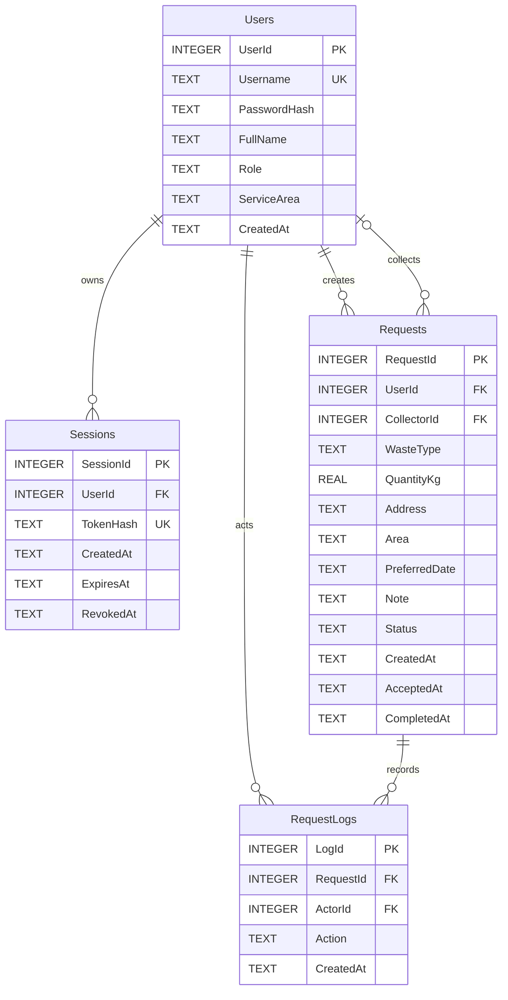

# Dữ liệu D1

Bốn bảng nghiệp vụ nằm trong `backend/schema.sql`. Wrangler có thể thêm bảng metadata migration; đó không phải bảng nghiệp vụ mới.

| Bảng | Khóa và dữ liệu | Ràng buộc |
| --- | --- | --- |
| Users | UserId PK; Username UNIQUE; PasswordHash; FullName; Role; ServiceArea; CreatedAt | Role thuộc DAN/THUGOM/ADMIN; chỉ THUGOM có ServiceArea |
| Sessions | SessionId PK; UserId FK; TokenHash UNIQUE; CreatedAt; ExpiresAt; RevokedAt | FK RESTRICT; token thô không lưu D1; application kiểm tra hết hạn/thu hồi |
| Requests | RequestId PK; UserId và CollectorId FK; WasteType; QuantityKg; Address; Area; PreferredDate; Note; Status; ba timestamp | CHECK enum, số kg (0,1000], địa chỉ 5–200, ghi chú ≤500, đồng nhất status/NULL timestamp |
| RequestLogs | LogId PK; RequestId FK; ActorId FK; Action; CreatedAt | CHECK CREATE/ACCEPT/COMPLETE; FK RESTRICT |



Các index hiện có phục vụ username/token unique, role, khu vực, session user/expiry, request status/area/user/collector và log request+created/actor. Dashboard aggregate vẫn quét dữ liệu phù hợp phạm vi đồ án; chưa tuyên bố tối ưu ở quy mô lớn.

Migration `0001_request_guards.sql` chỉ thêm trigger: chủ đơn phải DAN, trạng thái mới CHO_NHAN, mã khu vực cố định, ngày lịch hợp lệ, timestamp UTC có mili giây; UPDATE chỉ được chuyển tiến trạng thái, giữ dữ liệu tạo đơn, đúng collector THUGOM và thứ tự thời gian. Trigger không sửa dữ liệu cũ. Không dùng trigger để tự ghi log: API vẫn batch thay đổi và log. INSERT trực tiếp D1 cần tuân thủ cả hợp đồng log; quản trị DB là quyền tin cậy.

`AREA_OPTIONS` dùng `KHU_VUC_1` = Thuận An, `KHU_VUC_2` = Thủ Dầu Một. Nếu sau này thay danh mục, phải có migration mới cập nhật trigger và kiểm tra dữ liệu, không chỉ sửa shared file.

## Truy vấn kiểm chứng không chứa dữ liệu riêng tư

```sql
SELECT Status, COUNT(*) AS count FROM Requests GROUP BY Status;
SELECT WasteType, COUNT(*) AS count FROM Requests GROUP BY WasteType;
SELECT RequestId, CollectorId, Status, AcceptedAt, CompletedAt
FROM Requests ORDER BY RequestId DESC LIMIT 20;
SELECT RequestId, ActorId, Action, CreatedAt FROM RequestLogs ORDER BY LogId DESC LIMIT 50;
SELECT RequestId, COUNT(*) AS acceptCount FROM RequestLogs
WHERE Action = 'ACCEPT' GROUP BY RequestId HAVING COUNT(*) != 1;
PRAGMA foreign_key_check;
```

Trước migration trên dữ liệu cũ, kiểm tra area, `date(PreferredDate,'+0 days')`, role của owner/collector và timestamp sai thứ tự. Không tự sửa/xóa bản ghi lỗi. Thực hiện backup trước ghi remote; xem [deployment](DEPLOYMENT.md).
